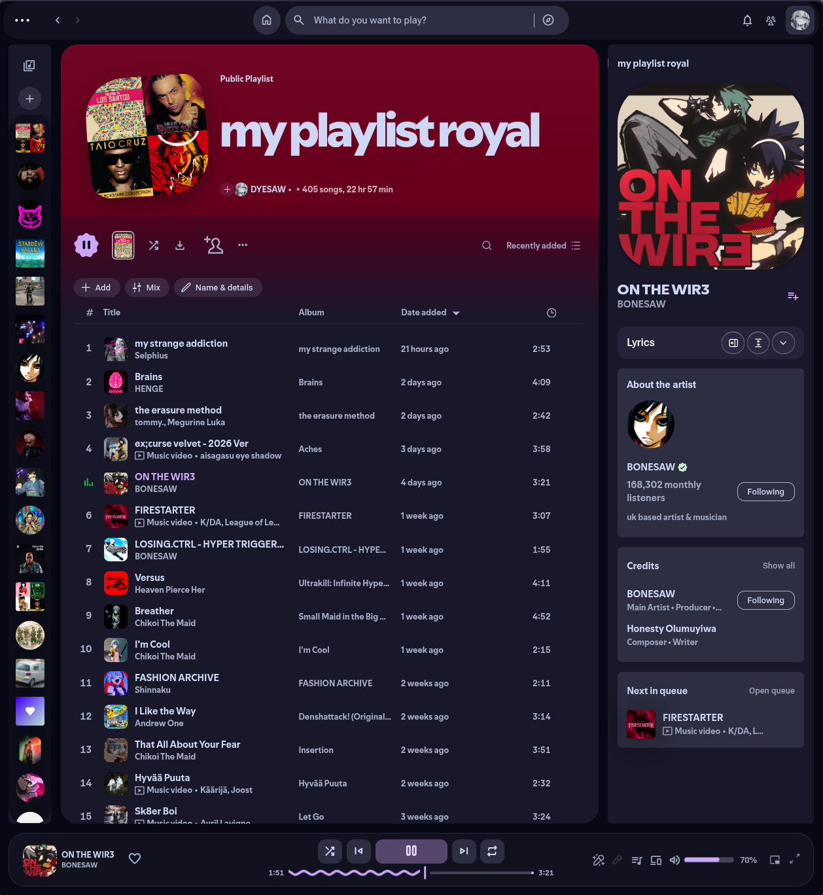

<div align = center>
<strong>
<hr>
<h1>Material 3 expressive Spotify</h1>
<br>
</strong>
</div>

## Installation:

Clone repo --> move files to path `~/.config/spicetify/Themes/` --> set them in spicetify config

### CLI:
```bash
cd ~/.config/spicetify/Themes/
git clone https://github.com/DYESAWW/material-expressive-spotify
spicetify config current_theme material-expressive-spotify
spicetify apply
```